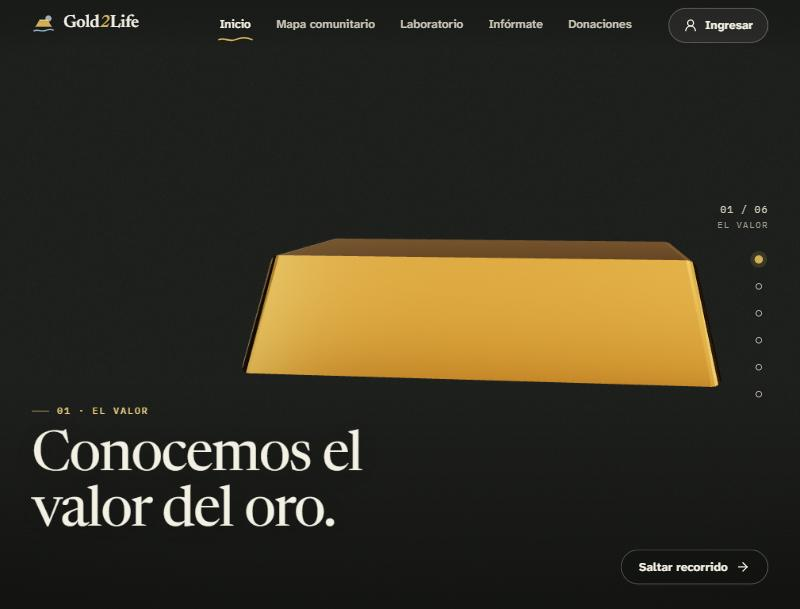
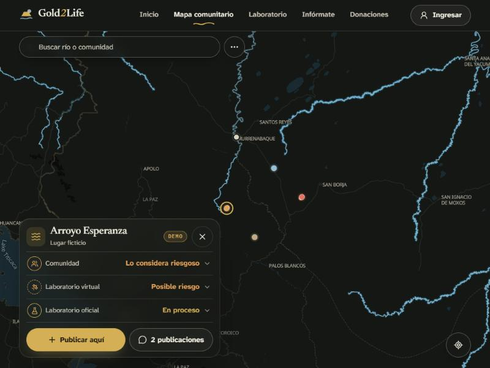
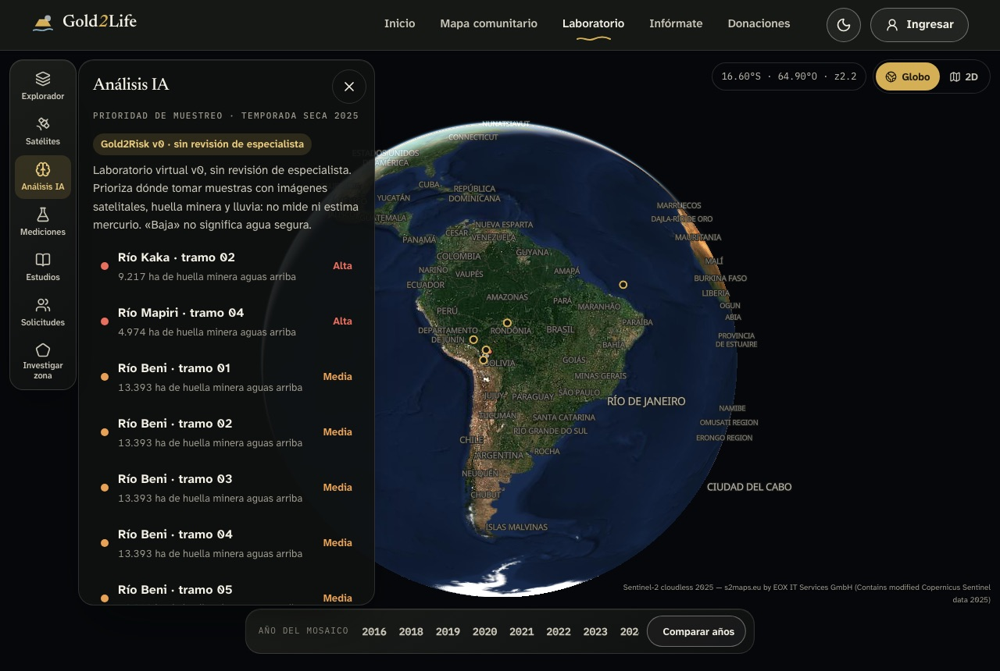
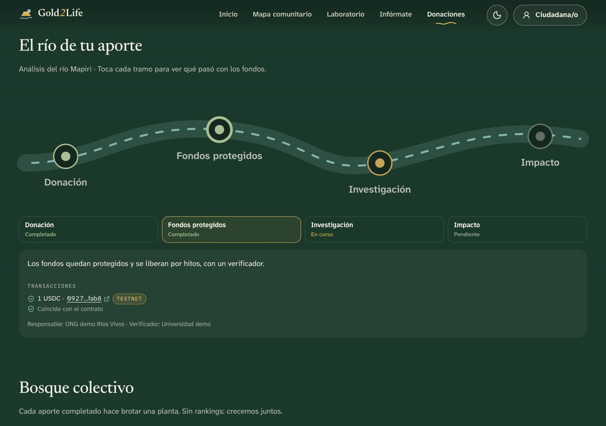

# Gold2Life

> **El satélite nos dice dónde buscar; la ciencia nos dice qué encontramos; la comunidad nos dice dónde hace falta actuar.**

Plataforma comunitaria, científica y de financiamiento frente al **mercurio de la minería aurífera** en la cuenca del río Beni (Bolivia). Proyecto para la hackathon **Gold4Good 2026**. «Gold2Life» es una marca provisional y configurable.



## Qué resuelve

El mercurio no se ve. Las comunidades ribereñas no tienen información comprensible sobre el agua que usan, los estudios están dispersos en PDF y pedir un análisis depende de tener contactos. Gold2Life conecta cinco actores que hoy no se hablan: **comunidades, investigadores, laboratorios, autoridades sanitarias y donantes**. Con eso, una necesidad local se convierte en una investigación respaldada por evidencia y en acciones financiables y trazables.

## Los cinco espacios

| | |
|---|---|
| **Inicio** | Un recorrido narrativo en 3D: el oro, el mercurio que se libera, el río, la mirada desde el espacio. Tiene una versión ligera para celulares modestos. |
| **Mapa comunitario** | Cada lugar muestra **tres señales separadas**: lo que dice la comunidad, lo que orienta el laboratorio virtual y lo que midió un laboratorio oficial. Se publica, se respalda y se pide un análisis; funciona sin conexión y comparte por QR. |
| **Laboratorio** | Globo con imágenes Sentinel-2 y MODIS, biblioteca científica, comparador de años, informes por zona y **prioridad de muestreo por tramo de río**. |
| **Infórmate** | Cartas cortas e ilustradas, con fuentes (OPS/OMS, PNUMA, planetGOLD, Minamata) y legibles sin conexión. |
| **Donaciones** | Campañas nacidas de casos reales, con **escrow por hitos en Stellar testnet** y un río de transparencia con cada transacción. |

<p>
  
  
</p>
<p>
  
  
</p>

## Principios de evidencia (no negociables)

- Una foto, un voto o una estimación satelital **no confirman mercurio**: solo lo confirma un análisis químico.
- Un resultado dentro del límite **no certifica potabilidad**, y **«no detectado» no es «ausente»**.
- Un resultado vale para **una muestra**, no para toda una comunidad.
- Una predicción **nunca se guarda como medición**.
- **Hervir el agua no elimina el mercurio.**
- No se inventan cifras ni alianzas; todo lo simulado se marca **DEMO**.

El servidor aplica estas reglas; no dependen solo de la interfaz. El detalle está en [`PROYECTO.md`](docs/PROYECTO.md).

## Arquitectura

```
apps/web          React 19 + Vite + MapLibre + three.js · PWA sin conexión · modo claro/oscuro
apps/api          NestJS 12 + PostgreSQL/PostGIS · reglas de evidencia, roles, sincronización, campañas
contracts/escrow  Contrato Soroban (Rust) · escrow por hitos en Stellar testnet con USDC de prueba
science/          Python · laboratorio virtual: huella minera, índices espectrales y prioridad por tramo
```

- **Sin conexión:** la PWA guarda los reportes en el teléfono. Un QR transporta el reporte (no un enlace) y el servidor sincroniza sin duplicar.
- **Escrow:** los aportes llegan hasta la meta y nunca la superan. El verificador independiente libera cada hito en orden, con el hash de la evidencia, y si la campaña se cancela cada donante recupera su parte proporcional. Contrato: [`CBJEQ…GJCI`](https://stellar.expert/explorer/testnet/contract/CBJEQGCIA24NJXIOIQPKIDUR4D3O5OPJGJMSNZJH3C3HP4FMQUZBGJCI).
- **Laboratorio virtual:** trabaja en la zona Guanay–Mapiri–Kaka–Beni, en las épocas secas de 2019 a 2025. Usa Amazon Mining Watch, Sentinel-2 y CHIRPS, con reglas explicables. **Prioriza dónde muestrear; no mide mercurio.** Detalle en [`science/README.md`](science/README.md).

## Empezar

Requisitos: Node 22+, Docker, y para el laboratorio Python con [uv](https://docs.astral.sh/uv/).

```bash
npm install
npm run api:db                                     # PostGIS en Docker + migraciones + semillas
npm run api:dev                                    # API en http://localhost:3000
VITE_API_URL=http://localhost:3000 npm run dev     # web en http://localhost:5180
```

Sin `VITE_API_URL`, la web funciona sola con datos DEMO locales.

**Pruebas**

```bash
npm run typecheck && npm run api:typecheck
npm run api:test                       # dominio + integración contra PostGIS real
(cd contracts/escrow && cargo test)    # contrato de escrow
(cd science && uv run pytest)          # piezas del laboratorio virtual
```

## Desplegar

```bash
cp .env.example .env              # completa POSTGRES_PASSWORD y JWT_SECRET (y Stellar si usarás campañas)
docker compose up -d --build      # db + api + web (nginx con proxy a /api)
docker compose --profile laboratorio run --rm ciencia cargar
```

HTTPS automático con Caddy, actualización y respaldos en [`docs/DESPLIEGUE.md`](docs/DESPLIEGUE.md).

## Documentación

- [`docs/PROYECTO.md`](docs/PROYECTO.md): el proyecto, sus actores y su flujo central.
- [`docs/ESTADO.md`](docs/ESTADO.md): qué está hecho, qué es real y qué es DEMO, y qué se probó.
- [`docs/TRABAJO-REALIZADO.md`](docs/TRABAJO-REALIZADO.md): resumen del trabajo de backend, escrow, laboratorio y despliegue.
- [`docs/FUENTES.md`](docs/FUENTES.md): fuentes y licencias de los datos.
- [`apps/api/README.md`](apps/api/README.md), [`contracts/escrow/README.md`](contracts/escrow/README.md) y [`science/README.md`](science/README.md).

## Datos y licencias

OpenStreetMap (ODbL) · Copernicus Sentinel-2 (Earth Search) · EOX Sentinel-2 cloudless · NASA GIBS (MODIS) · Amazon Mining Watch (CC BY 4.0) · CHIRPS v3 (UCSB). Las cifras de salud y mercurio citan su fuente; los lugares, personas y resultados de ejemplo son **ficticios y están marcados DEMO**.

## Estado

MVP funcional para la hackathon:
- **Real:** la base, los datos satelitales y de minería, el laboratorio virtual y el escrow en **testnet**.
- **DEMO:** las cuentas (ingreso por rol, sin autenticación real), los lugares y casos de ejemplo.
- **Sin confirmar:** las alianzas institucionales; ninguna está confirmada.

**Pendiente:** autenticación real, revisión de los umbrales por especialistas, validación con muestras de campo y pruebas en celulares de gama baja.
