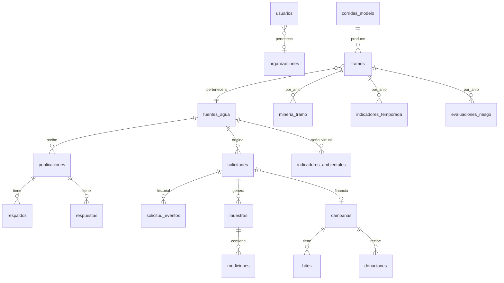

# API y modelo de datos

API REST en NestJS. En producción se sirve bajo `/api`, en el mismo dominio que la web. Valida las entradas con zod y responde en JSON. La autenticación de la demostración usa tokens JWT firmados por el servidor (`AUTH_MODE=demo`), y el rol se vuelve a leer de la base en cada petición.

## Rutas

| Método y ruta | Acceso | Descripción |
|---|---|---|
| `GET /health` | público | Estado, marca y versión de PostGIS |
| `POST /auth/demo` · `GET /auth/demo/personas` · `GET /auth/yo` | público · público · sesión | Ingreso por rol DEMO y persona de la sesión |
| `GET /water-sources?q=&bbox=` · `GET /water-sources/:id` | público | Lugares con las **tres señales separadas** y el estado de evidencia |
| `GET /communities?q=` · `GET /communities/:id` | público | Localidades y sus fuentes de agua |
| `GET /water-sources/:id/posts` · `POST /posts` | público · sesión | Publicaciones; idempotentes por UUID |
| `POST /posts/:id/corroborations` · `POST /posts/:id/comments` | sesión | Respaldar o cuestionar (con motivo) · responder |
| `GET /research-requests` · `GET /research-requests/:id` | público | Solicitudes con historial y acciones permitidas |
| `POST /research-requests` · `POST /:id/support` · `PATCH /:id/status` | sesión | Pedir, apoyar y avanzar el trámite (cada transición se valida en el servidor) |
| `POST /samples` · `POST /measurements` | laboratorio verificado | Muestra con cadena de custodia · resultado con método y límites |
| `POST /measurements/:id/reviews` | investigador o moderación | Revisión técnica por otra persona |
| `GET /water-sources/:id/measurements` | público | Solo mediciones validadas, con su alcance |
| `POST /sync/operations` · `GET /sync/communities/:id` | sesión · público | Lote idempotente de operaciones (propias o QR) · paquete para guardar sin conexión |
| `GET /escrow` · `GET /campaigns` · `GET /campaigns/:id` | público | Red y contrato · campañas · detalle con donaciones y estado leído del contrato |
| `POST /campaigns` | organización verificada asignada al caso | Crea la campaña en el contrato de testnet |
| `POST /campaigns/:id/donations/demo` | sesión | Aporte de prueba (cuenta DEMO del servidor) |
| `POST /campaigns/:id/donations/prepare` · `POST /donations/:id/submit` | público | Aporte con billetera: transacción sin firmar y envío de la firmada |
| `POST /milestones/:id/reviews` | organización verificadora | Libera el siguiente hito con el hash de la evidencia |
| `POST /campaigns/:id/cancel` · `POST /campaigns/:id/refunds` | moderación · público | Cancelación tras una disputa · reembolso proporcional |
| `GET /laboratory/tramos` · `GET /laboratory/tramos/:id` | público | Tramos (GeoJSON) con prioridad · serie por temporada |
| `GET /laboratory/runs` · `GET /laboratory/predictions` | público | Corridas con su manifiesto · predicciones de Hg (vacío: Gold2Mercury en pausa) |

## Modelo de datos

Tres migraciones SQL: `001_esquema`, `002_campanas` y `003_laboratorio`. Todo dato simulado lleva `demo = true`.

### Reglas expresadas en la propia base
- **Una predicción nunca es una medición:** son tablas distintas y no hay ninguna ruta de copia entre ellas.
- **«No detectado» exige el límite de detección y no guarda valor:** `CHECK (calificador <> 'no_detectado' OR (valor IS NULL AND limite_deteccion IS NOT NULL))`.
- **Quien carga un resultado no lo valida:** `CHECK (revisada_por <> cargada_por)`.
- **Una campaña tiene un verificador distinto de la organización:** `CHECK (organizacion_id <> verificador_id)`.
- **Solo testnet:** `CHECK (red = 'testnet')`.
- **El criterio normativo NB 512 lleva `verificado = false`** hasta confirmar el valor oficial de Hg.

### Estados de evidencia química
`sin_informacion`, `indicios_riesgo`, `hg_detectado`, `sobre_limite`, `dentro_limite` y `no_concluyente`. Se calculan en `apps/api/src/dominio/evidencia.ts`:
- solo con mediciones validadas;
- el criterio de agua solo se aplica a agua;
- una medición negativa posterior no borra una positiva anterior: el resultado pasa a no concluyente.

### Sincronización idempotente
`POST /sync/operations` recibe hasta 50 operaciones, cada una con su `opId`:
- **Reenvío:** si una operación se reenvía, el servidor devuelve el mismo acuse.
- **Reportes por QR:** se guardan con autoría declarada y quedan en moderación; quien los sube es transportista, no autor.
- **Lugar desconocido:** el reporte queda «por ubicar», sin perderse.
