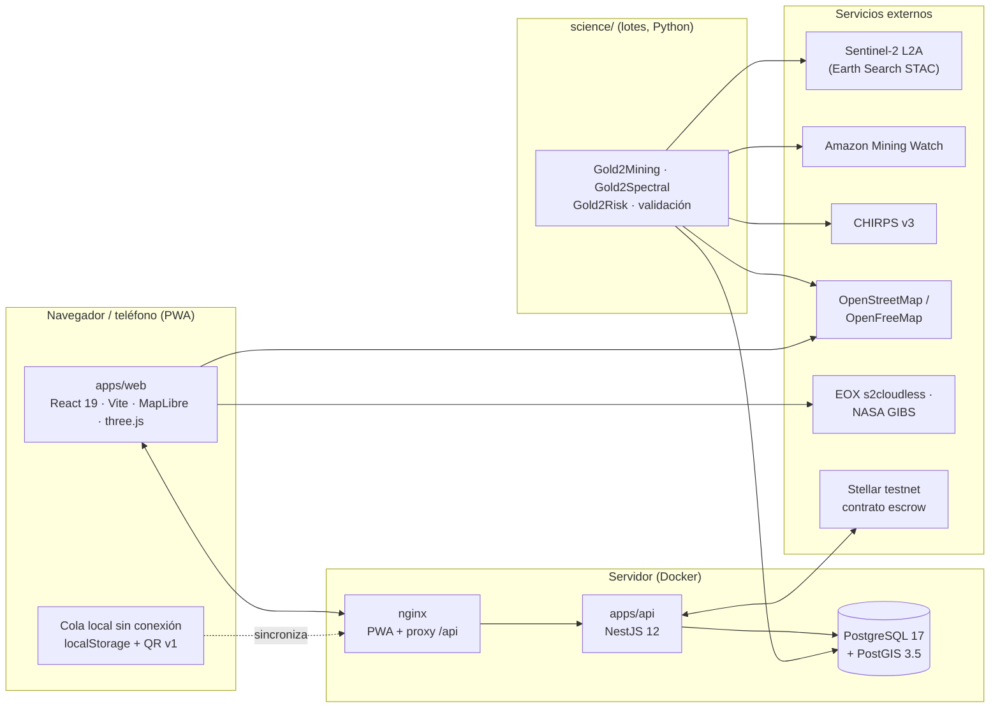
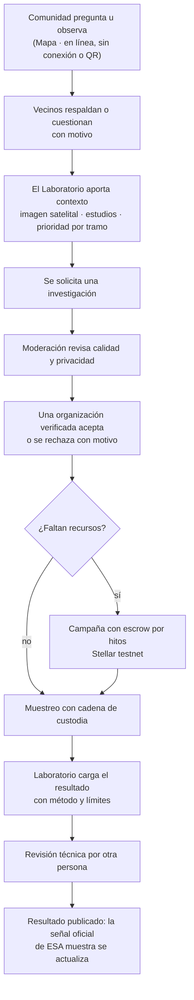

# Arquitectura y decisiones técnicas

## Vista general



| Componente | Tecnología | Responsabilidad |
|---|---|---|
| `apps/web` | React 19, TypeScript 7, Vite 8, MapLibre GL, three.js, GSAP, i18next | Los cinco espacios, la PWA sin conexión, el QR, el modo claro y oscuro y las sesiones por rol |
| `apps/api` | NestJS 12, `pg`, zod, jose, `@stellar/stellar-sdk` | Reglas de evidencia, permisos por rol, ciclo de solicitudes, sincronización idempotente, campañas y lectura del laboratorio |
| Base de datos | PostgreSQL 17 + PostGIS 3.5 | Lugares, publicaciones, solicitudes, mediciones, campañas, tramos e indicadores, con geometría |
| `contracts/escrow` | Rust, soroban-sdk 28 | Escrow por hitos en Stellar testnet |
| `science/` | Python 3.12, rasterio, pystac-client, shapely | Huella minera, índices espectrales, lluvia, reglas de prioridad y validación |
| Despliegue | Docker Compose, nginx, Caddy opcional | `db`, `api` y `web`, más los perfiles `https` y `laboratorio` |

## Flujo central



Los estados del trámite y quién puede pasar de uno a otro están en [`participacion-y-verificacion.md`](participacion-y-verificacion.md).

## Decisiones técnicas

| Decisión | Motivo | Alternativa descartada |
|---|---|---|
| Monorepo con workspaces de npm (`apps/*`), más `contracts/` y `science/` | Un solo `git clone` despliega todo; los tipos y contratos se revisan juntos | Repos separados para frontend y backend |
| PWA con cola local y QR que **contiene** el reporte | Las comunidades tienen conectividad intermitente; el QR viaja entre teléfonos sin internet | Requerir conexión para publicar |
| Las reglas de evidencia se validan en el servidor y no solo en la interfaz | Un cliente modificado no debe poder «confirmar» mercurio ni saltarse etapas del trámite | Validación solo en el frontend |
| PostGIS desde el inicio | Consultas por zona, distancia a ríos y tramos | Coordenadas en columnas numéricas |
| Migraciones SQL a mano, sin ORM | Las restricciones de evidencia se expresan como `CHECK` y quedan visibles y auditables | ORM con migraciones generadas |
| Compilación con SWC; typecheck con `tsc` 7 | El CLI de Nest no soporta todavía TypeScript 7 | Bajar a TypeScript 6 |
| Laboratorio en **lotes** de Python que escriben en PostGIS | El cálculo satelital es largo (~1,5 h) y depende de la red; la API solo lee resultados | Servicio de cálculo en vivo |
| Contrato de escrow propio en Soroban | Reglas explícitas (meta, orden de hitos, verificador, reembolso) sin depender de terceros ni API keys | Trustless Work (servicio externo) |
| USDC de prueba de Circle en testnet | Activo estable reconocible; en la hackathon nunca se usa dinero real | Token propio o XLM |
| nginx sirve la PWA y hace de proxy a `/api` | Mismo origen: sin CORS en producción y un solo dominio para HTTPS | Dominios separados para web y API |
| Marca configurable (`MARCA`, `VITE_BRAND_NAME`) | «Gold2Life» es un nombre provisional | Nombre fijo en el código |

## Repositorio

```
apps/web/                 Frontend (PWA)
  src/pages/              Inicio, Mapa, Laboratorio, Infórmate, Donaciones, Cuenta
  src/data/               Datos DEMO marcados y catálogos (cartas, estudios, lugares)
  src/lib/api.ts          Cliente del API (si no hay API, se usa el modo local)
apps/api/                 API
  db/migraciones/         001 esquema · 002 campañas · 003 laboratorio
  db/semillas/            Lugares reales sin resultados + datos DEMO
  src/dominio/            Reglas puras: evidencia, roles, solicitudes, QR, unidades
  src/campanas/           Escrow en Stellar (cliente del contrato)
  test/                   Pruebas de dominio e integración con PostGIS real
contracts/escrow/         Contrato Soroban y sus pruebas
science/                  Pipeline del laboratorio virtual
  config/parametros.yaml  Zona, periodo, umbrales v0
  g2/                     tramos, mineria, lluvia, espectral, riesgo, cargar, validacion
  datos/derivados/        Resultados versionados (~1,6 MB)
docs/                     Esta documentación
docker-compose.yml        Despliegue
```
