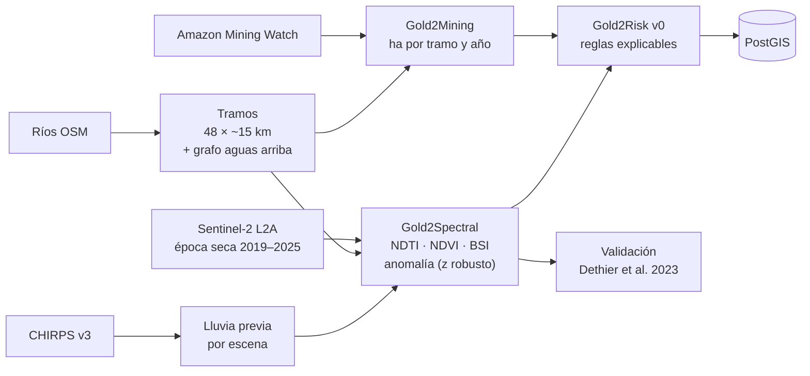

# Metodología del laboratorio virtual y uso de IA

## Qué se puede y qué no se puede afirmar

Gold2Life separa tres cosas que no son equivalentes:

| Nivel | Qué es | Qué produce Gold2Life | Qué **no** puede afirmar |
|---|---|---|---|
| 1. Actividad minera | Cicatrices de minería aluvial visibles desde el satélite | Hectáreas por tramo y por año (Gold2Mining, sobre Amazon Mining Watch) | Que se use mercurio en esa mina |
| 2. Indicadores de riesgo ambiental | Turbidez anómala, suelo desnudo, minería aguas arriba | Prioridad de muestreo por tramo (Gold2Spectral + Gold2Risk) | Que haya mercurio en el agua, ni su concentración |
| 3. Confirmación de contaminación | Análisis químico de una muestra concreta | Registro, revisión técnica y publicación del resultado (API) | Que el agua sea potable, ni que el resultado valga para toda una comunidad |

**Los satélites ópticos no detectan mercurio disuelto.** Miden reflectancia: sirven para estimar sedimentos, cambios en el río y suelo desnudo. Parte del mercurio viaja unido a partículas, pero esa relación depende del lugar. Por eso los niveles 1 y 2 solo orientan **dónde muestrear**.

## Componentes



### Gold2Mining: huella minera
No se entrena un detector propio: se reutiliza el ráster de cicatrices de **Amazon Mining Watch** (Earth Genome y Pulitzer Center, CC BY 4.0, 10 m).
- **Cálculo:** para cada tramo se suma el área minera confirmada por año en una franja de 3 km. Las franjas no se solapan entre tramos, para no contar dos veces la misma hectárea.
- **Aguas arriba:** «minería aguas arriba» es la suma del tramo más todos los tramos que desembocan en él.

### Gold2Spectral: indicadores espectrales
Para cada tramo y temporada seca se toma la **mediana** de NDTI en el agua, y de NDVI y BSI en la orilla, entre las escenas útiles: al menos 20 píxeles de agua y al menos 50 % del agua válida.
- **Anomalía:** cada temporada se compara con las demás del mismo tramo mediante un **z robusto**, (x − mediana) / (1,4826 · MAD), con un MAD mínimo para evitar valores extremos.
- **Lluvia:** se calcula la anomalía de la lluvia de los ~10 días previos (dos pentadas de CHIRPS). Si también es anómala, la turbidez podría ser natural.

### Gold2Risk v0: prioridad de muestreo
Son reglas explicables, no pesos ni probabilidades. Umbrales **v0, ilustrativos y sin revisión de especialista** (`science/config/parametros.yaml`):

| Regla | Prioridad | Condición |
|---|---|---|
| R1 | Alta | ≥ 20 ha de minería nueva aguas arriba en 2 años **y** turbidez anómala (z ≥ 2) en ≥ 2 de las últimas 3 temporadas, sin lluvia anómala que la explique |
| R2 | Media | ≥ 50 ha de huella minera acumulada aguas arriba |
| R3 | Media | Turbidez anómala en la temporada evaluada, no explicada por lluvia |

- **Sin regla y con datos faltantes:** el resultado es **«información insuficiente»**, nunca «baja».
- **Qué dice «baja»:** que no hay señales destacadas; no significa ausencia de mercurio ni agua segura.
- **Qué devuelve cada evaluación:** las reglas cumplidas, los datos usados y lo que faltó.

**Resultado de la temporada seca 2025:**
- **Alta:** 2 tramos, Kaka-02 y Mapiri-04.
- **Media:** 31.
- **Baja:** 14.
- **Información insuficiente:** 1.

### Gold2Mercury: en pausa
Era un modelo experimental para estimar Hg total en agua desde el satélite. No se entrena: no hay muestras de Bolivia con coordenadas para validarlo, y el único conjunto con pares muestra–imagen disponible (Gerson et al., 2022) es de Madre de Dios, Perú. El API devuelve `predicciones: []` y lo declara.

## Validación disponible

### Sedimentos (Dethier et al., 2023)
Dethier et al. publican sedimentos en suspensión estimados con Landsat y calibrados con mediciones de campo, a lo largo de los perfiles mineros del Mapiri y del Tipuani hasta el Beni (Zenodo 7699122, CC BY 4.0). Desde el inicio de cada perfil se recorren nuestros tramos río abajo y se compara la mediana de sedimentos con el NDTI de las épocas secas 2019–2021.

| Métrica | Valor |
|---|---|
| Pares tramo-año | 75 |
| Pearson r (log de sedimentos contra NDTI) | 0,49 |
| Spearman ρ | 0,25 |

**Cómo leerlo:** la relación es positiva, de débil a moderada. NDTI sigue la dirección de los sedimentos, pero no estima concentraciones. Se satura con cientos de mg/L, y las dos series vienen de sensores, fechas y métodos distintos. Esto respalda usar **anomalías** y no valores absolutos. **No es una validación con mediciones directas de campo.**

### Mercurio y sedimentos (literatura)
En el río Beni, el mercurio total varió de 19 ng/L en época seca a 460 ng/L en crecida, con entre el 59 % y el 98 % asociado a partículas; en los sedimentos, el mercurio se correlacionó con la arcilla (r² = 0,74) (Maurice-Bourgoin et al., 2002). Esto sostiene que vigilar sedimentos ayuda a priorizar; no convierte la turbidez en una medida de mercurio.

### Pendiente
La validación decisiva es **tomar muestras en tramos de prioridad alta y baja** y analizarlas en un laboratorio competente. Ver [`roadmap.md`](roadmap.md).

## Uso de inteligencia artificial
- **Detección minera:** la hace el modelo de Amazon Mining Watch (red neuronal de sus autores), y Gold2Life usa sus resultados publicados.
- **Gold2Spectral y Gold2Risk** no son modelos de aprendizaje automático: son índices físicos, estadística robusta y reglas explícitas, para que cada prioridad se pueda explicar y auditar.
- **En el diseño de datos, la IA no vota ni certifica.** Una estimación nunca se guarda como medición, y la señal «Laboratorio virtual» se presenta siempre separada del resultado químico.

## Reproducibilidad
```bash
cd science && uv sync
uv run python -m g2 tramos | mineria | lluvia | espectral | riesgo | cargar | validacion
```
Cada paso queda registrado en `datos/derivados/manifiesto.json` (fecha, commit, fuentes y conteos) y en la tabla `corridas_modelo`. Los resultados (~1,6 MB) están versionados en el repositorio.
