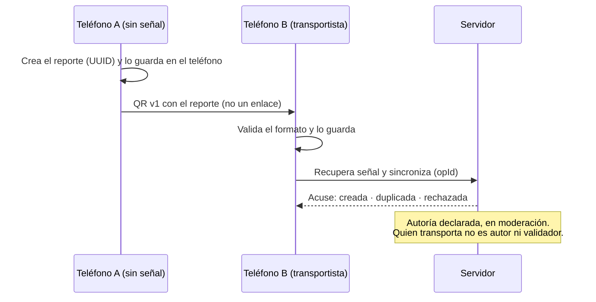
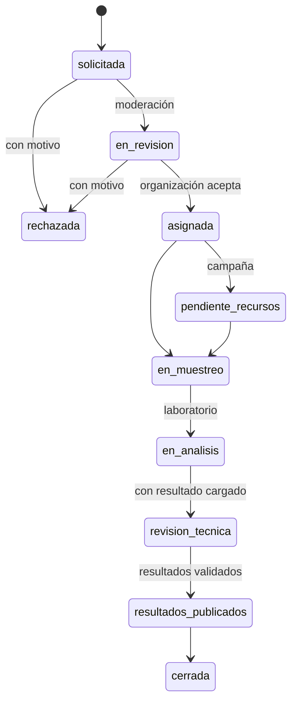

# Participación comunitaria y verificación

## Principios
1. Una foto, un testimonio, un voto o una estimación satelital **no confirman mercurio**.
2. Un resultado dentro del límite **no certifica potabilidad**.
3. **«No detectado» no es «ausente»**: depende del límite de detección del método.
4. Un resultado vale para **una muestra**, con su lugar, fecha, matriz y método.
5. **Una medición negativa posterior no borra una positiva anterior.**
6. **El umbral de agua potable no se aplica** a peces, cabello ni sedimentos.
7. **Hervir el agua no elimina el mercurio.**
8. **No se inventan cifras, alianzas ni datos;** lo simulado se marca DEMO.
9. **Una predicción nunca se guarda como medición.**

## Participación
- **Publicar:** «Lo vi» (observación), «Pregunta», «Pedir análisis» y, solo para la autoridad sanitaria, «Aviso oficial».
- **Respaldar o cuestionar:** cuestionar exige un motivo. Nadie puede respaldar su propia publicación, y una recomendación oficial no se vota.
- **Señal «Comunidad»:** se vuelve «la comunidad lo considera riesgoso» cuando al menos 3 personas distintas reportan o respaldan un «Lo vi». **Sirve para priorizar; nunca cambia el estado químico.**
- **Representante comunitario:** puede registrar solicitudes en nombre de familias sin celular, siempre con consentimiento explícito.

## Sin conexión y QR

**El QR no lleva** fotos, contraseñas, datos médicos ni ubicaciones exactas de viviendas, y no prueba identidad ni contaminación.

## Roles y permisos
| Rol | Puede | No puede |
|---|---|---|
| Visitante | Consultar | Publicar |
| Ciudadano/a | Publicar, respaldar, pedir análisis y donar | Confirmar mercurio |
| Representante | Lo anterior, y registrar en nombre de familias con consentimiento | — |
| Investigador/a | Revisar resultados y verificar hitos (si su organización verifica) | Validar su propio resultado |
| Laboratorio | Registrar muestras y cargar resultados de su método | Emitir recomendaciones oficiales |
| ONG | Aceptar casos y proponer campañas | Verificar su propia campaña |
| Autoridad sanitaria | Emitir recomendaciones oficiales | — |
| Moderación | Revisar solicitudes y cancelar campañas tras una disputa | — |

**Rol no es validez científica.** Las acciones institucionales exigen un rol **verificado**, y un resultado necesita revisión técnica por **otra persona**.

## Ciclo de una solicitud

El servidor rechaza cualquier transición:
- que no corresponda al rol;
- de una organización que no es la asignada al caso;
- de rechazo sin motivo;
- hacia revisión técnica sin un resultado cargado;
- hacia la publicación con resultados sin revisar.

## Financiamiento trazable
- **Origen:** una campaña nace de un caso aceptado y la propone la organización asignada.
- **Verificador:** es una organización distinta de la que propone la campaña.
- **Escrow** (Soroban, testnet):
  - acepta aportes hasta la meta;
  - libera los hitos en orden, firmados por el verificador y con el hash de la evidencia;
  - si la campaña se cancela, devuelve a cada donante su parte proporcional.
- **Confirmación:** una donación se confirma por la red, no por la interfaz, y la API la concilia con el estado del contrato.
- **Qué no va en la cadena:** datos personales ni ubicaciones; solo direcciones y una referencia opaca (sha256).
- **Lo que la cadena no hace:** da trazabilidad del dinero, pero **no valida la ciencia**.
